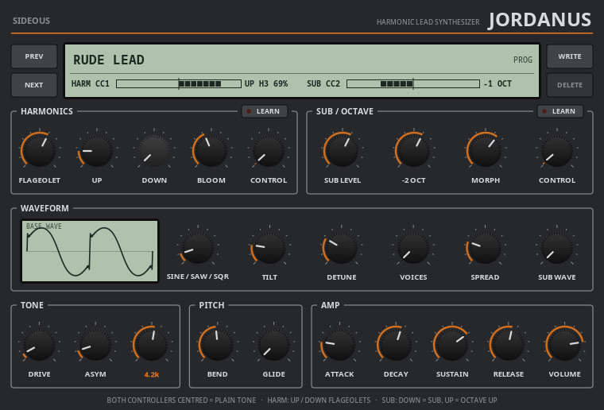

# Jordanus


> **⚠️ VIBE CODED SLOP.** This entire plugin — DSP, GUI, CI — was built through
> conversational back-and-forth with an AI, not hand-engineered from a spec.
> It works, it's been tested, but go in with appropriate expectations.

A monophonic, guitar-like solo lead synth (VST3 / LV2 / CLAP / JACK
standalone), built on [DPF](https://github.com/DISTRHO/DPF) with a Cairo UI.
The whole expression lives on the controllers:
**velocity and aftertouch are deliberately ignored.**



## Playing it

| Controller | Does |
|---|---|
| First strip / joystick axis (**Harmonics CONTROL**, default CC1) | bipolar, centre (CC 64) = plain tone: up swells in a flageolet (default 3rd harmonic), down another one (default 2nd), each pushing the plain tone down as it comes in; **UP** / **DOWN** pick which harmonic (2nd–8th) |
| Second strip / joystick axis (**Sub CONTROL**, default CC2) | bipolar, centre (CC 64) = plain tone: down brings in a −1 then −2 octave sub, up moves the whole tone +1 then +2 octaves |

**With both controllers centred you get the plain tone** (fitted to the
reference `base.wav`); a spring-loaded joystick is the intended controller.
| Pitch bend | ±12 semitones by default (up to ±24) |
| Keys | mono, last-note priority; legato doesn't re-attack, releasing a key falls back to the still-held one |

Both CONTROL assignments have a **LEARN** button: click it, move the strip /
wheel / knob you want, done (click again to cancel). Learning binds MIDI CCs,
so a strip that sends pitch bend can't be learned - that one is pitch bend.

The **WAVEFORM** panel shapes the oscillators directly, with a live preview
of one cycle of the plain tone (computed by the same code as the DSP):
**SINE / SAW / SQR** (one knob: plain sine → full saw at the middle → square),
**TILT** (harmonic rolloff 1/n^0.5 … 1/n^2),
**DETUNE** (the body's two copies at ±0–25 cents: the "wobble"/thickness),
**VOICES** / **SPREAD** (1–7 detuned unison copies of the base oscillator -
a supersaw with the wave on saw; level-normalised; flageolets and subs stay
single) and **SUB WAVE** (sine → square).

**AMP** is a full ADSR. The default (decay 0.25 s to 70 %) matches the
reference; drop SUSTAIN for a harder, guitar-like attack. **FLAGEOLET** (in the HARMONICS panel) is
the flageolets' own waveform on the same sine → saw → square scale.

Each direction of the harmonics controller has exactly one flageolet (no
stepping through other harmonics - the references never do): the further
you push, the louder it gets and the more it displaces the plain tone.
**BLOOM** smooths how quickly it follows the controller; **MORPH** does the
same for the
SUB / OCTAVE controller.

## How the sound was derived

The engine was fitted to reference recordings of the target sound
(spectra over time, pitch tracks, single-cycle waveforms):

- **Plain tone** (`base.wav`, both controllers centred): nearly a sine, 3rd
  harmonic at −29 dB, upper harmonics around −30…−45 dB.
- **Flageolets** (`harm1.wav` up → 3rd harmonic, `harm2.wav` down → 2nd):
  a single harmonic swells in over ~0.15 s while the plain tone fades
  15–40 dB under it; the flageolet is a whole waveform at k·f between saw
  and square.
- A narrow **cabinet resonance around 4 kHz** with a steep rolloff above it.
  When high notes or flageolets put the dominant partial on that bell (or
  past the rolloff), the level is compensated from the filters' actual
  response.
- The subs go **into the distortion together with the lead**: the references
  show intermodulation sidebands (f ± f/4, f ± f/2) that only a shared
  nonlinearity makes. All oscillators run off one phase accumulator at f/4,
  so the subs can't beat against the lead.
- **Body**: the references' upper harmonics wobble in level by 40–90% while
  the fundamental stays steady, so the 1/n body layer is two copies detuned
  ±7 cents around a locked fundamental.
- Bends in the references are manual (S-curved octave dive ≈0.9 s, one-sided
  upward "guitar" vibrato), so there's no built-in vibrato LFO, just a wide
  bend range.

## Building

```sh
git submodule update --init --recursive
./install.sh            # builds and installs VST3 + LV2 + CLAP into ~/.vst3, ~/.lv2, ~/.clap
```

`plugins/Jordanus/tools/` has two dev aids that aren't part of the build: an
offline UI → PNG renderer and a DSP renderer that writes scripted
performances to WAV for analysis.
